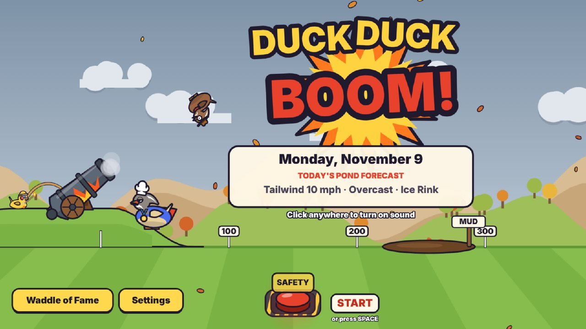
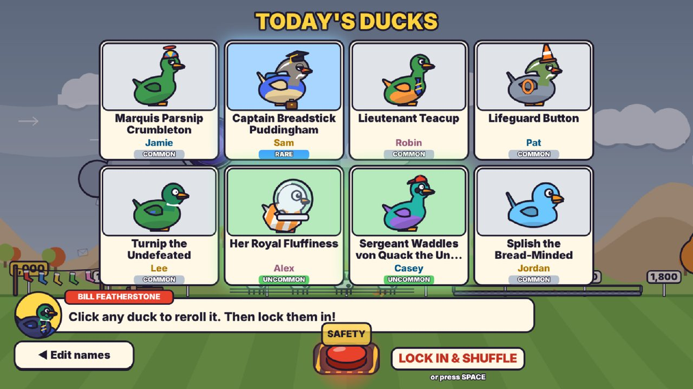
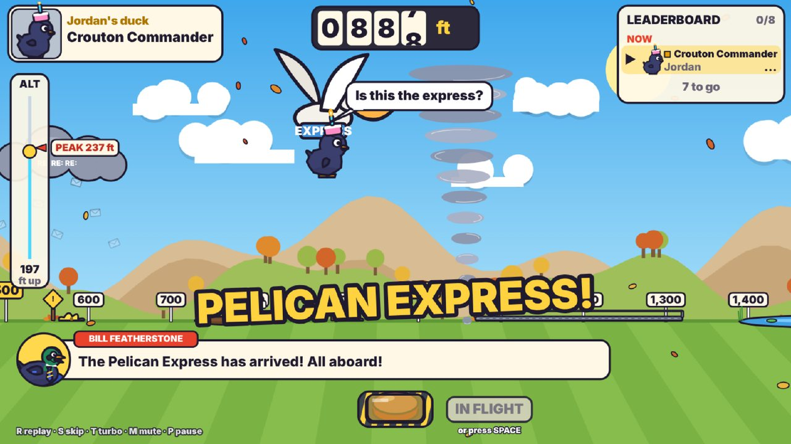
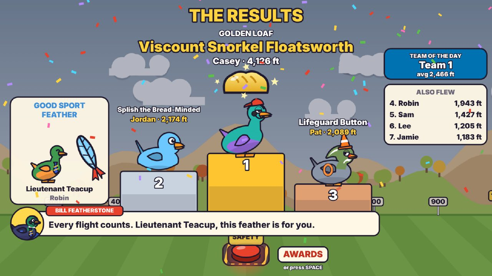
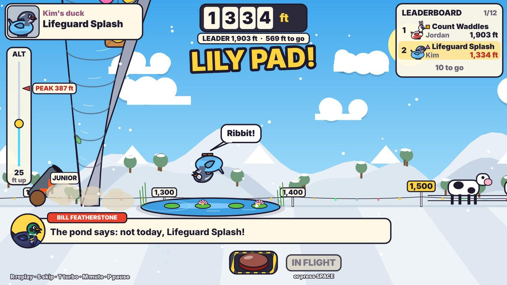

# Duck Duck BOOM!

<p align="center">
  <a href="https://sauterreed24.github.io/duck-duck-boom/"></a>
</p>

<p align="center">
  <b><a href="https://sauterreed24.github.io/duck-duck-boom/">▶ Play now</a></b>
  &nbsp;·&nbsp; <a href="https://raw.githack.com/sauterreed24/duck-duck-boom/main/index.html">Backup link</a>
  &nbsp;·&nbsp; <a href="https://github.com/sauterreed24/duck-duck-boom/blob/main/index.html">Download to play offline</a>
</p>

<p align="center"></p>

A daily cannon-launch duck game for team calls. Everyone who booked a meeting today gets a randomly generated duck. **Ol' Thunderbill** takes the whole flock in one barrel and fires them all at once (the **salvo**) across a field full of trampolines, geese, reply-all storms and the occasional UFO. The duck that lands farthest takes home **the Golden Loaf**.

| Reveal today's ducks | Fire them all at once | Crown the winner |
| --- | --- | --- |
|  |  |  |

<p align="center"><br><em>Every day's field is different, and no single obstacle gets to stop the show: a lily pad bounces this duck back out of the pond while the tornado wanders past.</em></p>

It is one self-contained file, `index.html`. There are no frameworks, CDNs, web fonts, images, audio files or network requests. Every visual is drawn with Canvas 2D and every sound is synthesized with the Web Audio API, so it runs offline in Chrome or Edge.

## Running it

- **Play from this page:** click **Play now** above. It opens the game at <https://sauterreed24.github.io/duck-duck-boom/>, served by GitHub Pages from the `main` branch. Nothing to install, and it updates itself about a minute after every change to `main`.
- **Backup link:** `index.html` through raw.githack.com (a free service that serves files from public GitHub repos), in case Pages is ever unavailable. It caches, so it can be a version or two behind the Play link.
- **Offline:** download `index.html` and double-click it.

Your roster, settings and Waddle of Fame are saved in the browser for whichever link you use. Each link keeps its own copy, so stick to one. To move your data, use **Settings → Export everything** on the old link and **Import…** on the new one.

### On a Teams call

1. Share the **browser window or the whole screen**, and turn on **Include sound** in the share bar.
2. Keep the game window uncovered and in front. Browsers throttle hidden or covered tabs, which makes the show stutter.
3. Press **F** for fullscreen. The 16:9 stage scales to any window.
4. Click once before the call starts. Browsers only allow audio after the first click.
5. Turn on **Auto-advance** if you want it to run hands-free, or leave it off and banter between ducks.

If your computer is set to reduce motion, the game starts with screen shake off, skips the photo-finish flash and keeps the camera wide during a spotlight (the slow motion stays). Screen shake can be switched on or off in Settings either way.

If the laptop struggles while screen-sharing, the game notices the dropped frames and quietly renders at a lower internal resolution, then steps back up when things are smooth again. You don't need to change anything.

## The show

There are five screens, and the **big red button** (or **Space**) is the only control you need.

1. **Title:** the animated logo, Ol' Thunderbill idling with a smoldering fuse, today's date and the Pond Forecast teaser. If today's show was interrupted, the button reads **RESUME SHOW**. A finished show never comes back on the big button: it's already in the Waddle of Fame, and **Last results** stays on the title until another show finishes, reopening the panorama for copying (it steps aside while a new show is in progress, and comes back if that show is abandoned or sent back to Edit names). Pressing **DONE** there returns to the title and leaves it in place. A practice show is never kept, not even after a reload. An unfinished show from an earlier day leaves the big button on **START** and gets its own dated **Resume** button instead.
2. **Who booked today?** A saved roster grouped by three teams, up to 40 ducks. See [Editing today's names](#editing-todays-names) below. You can also tick **Practice race** (not saved; it covers one show and then switches itself off, and the big button says so), **Auto-advance**, **Turbo** and **Salvo** here (untick Salvo to launch the ducks one by one instead).
3. **Duck reveal:** cards flip in a cascade and pause on Epic and Legendary ducks, which get their rarity stamped across their own card (a reroll that lands one gets the stamp too). Once the cards are up, Bill reads out one duck's scouting report (a bio and three stats, which are for vibes only; the one-by-one intro cards show every duck's). Click any card to reroll that duck: the card under the pointer rises a touch, and its duck hops and quacks hello in its own voice. Spotted a typo or a missing person? **◀ Edit names** goes back to the roster before anything starts. **LOCK THEM IN** locks the ducks, then the **Pond Forecast** pops up over the dimmed cards (with Bill's outlook for the day: "Chance of geese: 40%.").
4. **The salvo:** every duck hops into the cannon (a counter on the barrel keeps score). The safety cover flips open, then **LIGHT THE FUSE** runs the 3-2-1 countdown and "FIRE IN THE DUCKS!" sends the whole flock up together. One camera follows the ducks that are still moving. Every duck wears its player's name; call-outs pop up over whatever happens to it, and a duck whose flight was too quiet for any of them gets one as it lands (TOUCHDOWN!, or its player's name and distance when a crowd has hidden its name tag); when Bill's line is about a duck, that player's name tag (with the duck's portrait) sits on his caption bar, so everyone knows whose duck he means; the one or two biggest moments get a slow-motion close-up; arrows on the edge of the picture point at ducks that have left it (the one in space, say). The leaderboard re-sorts live as ducks pass each other, a crown marks whoever is in front, and Bill calls it like a race. Each duck plants its flag where it stops. Once the duck in front has stopped, a **CHASING** chip under the distance counter names the closest duck still moving and counts down the feet it still has to close (it turns green as the chaser goes past). A chaser that stops less than 100 ft short gets a **SO CLOSE!**, and a winner who survives a late charge gets told so. Ducks that come to rest in the same spot pile up: the later one hops onto the first one's back (**DUCK STACK!**, up to a four-duck tower). The piles are only for show: every distance is still where the duck's feet stopped. When only one is still going, everybody watches that one, and Bill stays with it: each milestone it passes, how far it still has to go to catch the leader, and the moment it takes over. Then the farthest duck gets its card and **SEE RESULTS** takes over.
5. **Results:** the awards come first, as the warm-up: three of them, which go to three different ducks (a duck that already holds one steps aside, so the stats leader doesn't sweep them; new ones such as **Self-Made Duck** (the farthest flight with no boosts or obstacles), **Hard Knocks** and **Low Rider** tend to find somebody else, and **Best Dressed** favours the rarest look; in the salvo, two awards tell how the race was run: **Early Bird** for a duck that led the flock for 6 seconds or more and then finished off the podium, and **Late Bloomer** for a podium duck that was a third of the field further back well into the flight; each turns up in roughly a third of shows of a dozen ducks or more, less often in a small show), with three highlight stories, the winner's among them (each names the duck's player in brackets the first time it comes up, on screen and in the copied results) (a Golden Loaf won by less than 25 ft is a story of its own, and so is a duck stack; a story one of the awards already tells isn't told again; a solo run goes straight to the Golden Loaf). The big button then reads **THE GOLDEN LOAF**, and the podium is the finale: a drumroll while second and third rise and the loaf comes down, then the winner's name pops in with a cymbal, the fanfare and confetti (with the winning margin when it's close), the runner-up has a word about it ("Recount!" when it lost by a few feet), the Good Sport Feather, Team of the Day and a list of everyone else. A press during either reveal finishes it, so nobody misses the crowning; the next press moves on. The show ends on the podium: **DONE** (or **Close these results** in the pause menu) on a real show returns to the title and leaves **Last results** there until the next finished show replaces it (on a practice show it discards it). **Copy results** (the text for the team chat: 🥇🥈🥉 for the top three, a line for a new pond record, the awards, Team of the Day, the Good Sport Feather and a highlight; Bill signs off at the bottom) and **Panorama** (every landing flag, the top five and last place labelled with their players' names) are buttons on the podium for whoever wants them.

### Editing today's names

The roster is saved in the browser, so you only build it once. Each day you just change who's ticked.

- **Today's list** (the quickest way): paste or type who booked today, one name per line. Add `, Team 2` (or a team's name) to set the team. Rows copied from a spreadsheet (tab-separated; only a cell that is just a team, like `Team 2` or `2`, sets the team; a header row is skipped), `Last, First` names (`Doe, Jane, Team 3` too) and attendee lists from Outlook, Teams or Gmail (`"Name" <email>`, `Last, First <email>; ...`, `Name <email>, Name <email>` or bare addresses) are understood too. `Jamie, Sam, Robin` is three people, and `Jamie, Sam` with both already on the roster ticks both. **Tick only these** ticks exactly those people and unticks everyone else. **Add to ticked** keeps the people already ticked. New names are added to the roster automatically, and bullets or numbers at the start of a line are ignored, so you can paste straight from a chat message. An empty box changes nothing. With nobody on the roster yet, pressing the big button says so and puts the cursor in this box.
- **Add one person:** type a name and press Enter. Someone already on the roster is just ticked (no second duck).
- **Fix a name:** click it and type. Enter saves, Esc undoes. A blank name goes back to the old one, and a name that's already taken gets a `(2)` suffix.
- **Tick or untick** anyone with the checkbox, or a whole team with **All** / **None**. The two small coloured dots on each row move someone straight to that team, and **×** removes them from the roster (an **Undo** button stays up for 10 seconds in case of a slip). Anything half-typed in the side boxes stays put while you tick and untick.
- **Find a name** filters the lists when the roster gets long. Names are sorted alphabetically within each team.
- **New day:** if ticks are left over from an earlier day, a yellow banner offers to untick them. Each person's tick remembers its day, so people you tick or add today are never caught by it.
- **More than 40 ticked:** the warning names who sits out (the roster's own order: team, then name), and so does a note when the show starts.
- **During the show** (press **P**): **Add a late player** puts them in the cannon if the fuse is not lit yet, or gives them a **LATE VOLLEY** of their own afterwards, whose card shows where they placed (and ticks them on the roster if they were already on it), and **Remove someone who hasn't launched yet** takes out a duck that was ticked by mistake.

### Keys

| Key | Action |
| --- | --- |
| Space | The big red button |
| R | Instant replay of the volley (or of the last flight in one-by-one mode). Replays use the quicker turbo pacing and are never scored twice. |
| T | Turbo: quicker loading and countdown, and a flight in a little over half the time. |
| S | Skip ahead: past the loading, from the armed wait into the countdown, past the countdown (the cannon fires), or straight to the landing. The landing skip is silent: the flight is scored and the result card shows, with no cheer, fireworks or new captions. A second press is what lands them after the countdown skip. |
| M | Mute |
| N | Music on or off |
| F | Fullscreen |
| P | Pause and settings: add a late player, remove a duck that hasn't launched, teams, volume, data. Pause freezes everything, sound included. P again resumes. |

Hotkeys are ignored while you're typing in a text field. Esc stays the browser's fullscreen exit.

### Pacing

A whole salvo show runs about a minute from the first duck hopping in to the results: loading about 5 s, the countdown 3 s, and a flight of about 29 s for a dozen ducks (about 33 s with 40, and rarely past 36 s; an Ice Rink, Low Gravity or Bouncy Day full of long slides and bounces can stretch to about 38 s). One duck alone flies for about 14 s. Turbo brings a 12-duck flight down to about 18 s, and a turbo flight rarely runs past 21 s.

The salvo plays at full speed while it matters: the launch, every event, and as long as two or more ducks are in the air. Once most of the flock is down, the stragglers' quiet stretches run faster (the speed only ever eases up and down), and every duck's final stop near the end plays at full speed again. A finish within 25 ft gets a **PHOTO FINISH!** in slow motion with one soft camera flash, and a drumroll builds over the last seconds. The one or two biggest moments of a volley (a UFO, a second cannon, a tornado, a wormhole, a trip to space) get a **spotlight**: cinema bars slide in, the camera leans in on that duck (up into the sky if that's where it is), and the moment itself plays in slow motion before the camera pulls back out to the flock. In a wide shot of a dozen ducks those moments used to be specks. Spotlights are picked from the flights themselves, so a replay gets the same ones. They stay clear of the launch, the finish and each other, and a volley too long to fit them skips them. About two volleys in three get at least one.

**One-by-one mode** is still there for a longer show: untick **Salvo** on the roster screen or in Settings (or open the page with `?classic`). Then each duck gets its own intro card, ladder climb, countdown and flight, about 24 seconds per duck: intro 1.5 s, ladder and gauges 2.5 s, countdown 3 s, the flight and a 2.5 s result. A flight with no events plays for about 11 s, a typical one about 12 s, and one packed with events 15–20 s (9 in 10 flights are done within 19 s; the rare monster flight tops out around 25 s). In turbo a typical flight takes about 8 s. Distances are identical in both modes: each duck flies the same seeded flight either way.

In one-by-one mode, flights play close to real time. The launch always plays at exactly full speed, and every event, the landing and the finish play at or very near it. Only quiet stretches run faster, and the speed always eases up and down, so the duck never appears to skip ahead. Close to the ground it barely speeds up; it speeds up most high in the sky, where the camera is zoomed far out. A long quiet slide or bounce-out is fitted into a few seconds, and the camera pulls back while it runs faster so the scenery never streaks past. Captions and speech bubbles always run in real time and stay up for at least 2 seconds. Shows with more than 15 ducks start in turbo.

## What's in it

- **Ducks:** seeded per player per day (local date + name), so a reload gives the same duck. There are 5 base types (mallard, classic rubber duck, fluffy duckling, white farm duck, Carolina duck), 16 colors, 6 patterns, 16 hats, 17 accessories and 8 eye styles. Rarities are Common 60%, Uncommon 25%, Rare 10%, Epic 4% and Legendary 1%. The six legendaries are Golden Duck, Disco Ball Duck, Robo-Duck, Ghost Duck, Pixel Duck and Definitely A Duck (a goose in a duck costume). Names mix templates with 96 handwritten one-offs and avoid names used on recent days. Every generated name, bio and caption goes through a blocklist, and any duck name containing a first name from the roster is rerolled. Looks never affect distance, but Epic and Legendary ducks show off in the air: an Epic duck's trail sparkles, and each Legendary leaves its own (gold glints, disco colours, robot sparks, a ghostly haze, 8-bit pixels, white feathers).
- **Events:** 14 boosts, 12 obstacles (pond plop included), 7 wildcards and 10 gags. The newest: the **kicker ramp**, on most days' courses, sends a duck that comes in fast (sliding, or in a low hop that meets the ramp) up the curve and off the lip (**SEND IT!**); a slower duck rolls up and over it, and a crawling one stops at its foot. It catches about 4% of a day's ducks (13% on the busiest day). It is placed from its own random stream, so the rest of each day's course is laid out exactly as before, and every flight that never touches it is unchanged. And a **notification** pops up beside a duck in the air now and then ("Reminder: you are in a cannon."). Each one is a data entry in `C.EVENTS` with its trigger, physics effect, art, sound and caption. Ground set pieces come from the day's course and trigger on a seeded chance per flight. Air events trigger by chance in their altitude band. Gags never change distance.
- **No bottlenecks:** every day's course is test-flown 400 times before the show (the same test flights for everyone, seeded by the date; it happens in the background while the title screen is up, so the page still opens instantly). Anything that catches more than its share of the ducks is toned down until it does not: a dead stop such as the pond, the mud or the bread bench may catch about 1 duck in 11, a wildcard 1 in 8, a boost 1 in 7. A pond in a busy spot gets a little smaller and grows flowering lily pads, and some ducks that come down in it bounce off one and hop back out (**LILY PAD!**). A fast, flat arrival always skips across the water. The **tornado wanders** back and forth across about 400 ft, so every duck meets it somewhere else, and it is a real wildcard: about 3 ducks in 4 are flung onward, the rest back, and a caption calls it as the duck comes out (**FLUNG ONWARD!** or **WRONG WAY!**). Riders leave the moving walkway at their own pace instead of in a bunch.
- **Cannon moments:** misfire with a bonus-powder comeback (about 1.3%), backfire to a negative distance (about 1%) and the fake-out fizzle (about 2%, cosmetic only). Other flight touches are the hat that flies off and sometimes beats its duck, a photo finish in slow motion when a duck lands within 25 ft of the leader (with the margin called out), **personal bests**, and a drumroll for a last duck who can still win, which builds over the final seconds of the flight and ends right on the landing cymbal.
- **Daily conditions:** wind (calm, tailwind or headwind, up to 20 mph), sky (sunny, overcast, drizzle, fog with haze drifting across the hills, sunset, or night with a few twinkling stars, the field and hills dusky in every season) and a modifier of the day on about half of days: Low Gravity, Bouncy Day, Goose Migration, Trampoline Park, Ice Rink (the field turns to ice and some ponds freeze over), Big Head Mode, Throwback Mode or Turbo Cannon. Fridays add Fri-Yay party mode. Seasonal themes come from the date: pumpkins and bats in October, falling leaves in autumn, a turkey in a duck disguise during Thanksgiving week, snow and twinkle lights from December to February, flowers and rain in spring, and a beach in summer. The course changes daily too.
- **Commentary:** Bill Featherstone narrates in a lower-third caption bar (about 550 lines), and the ducks talk back in speech bubbles (about 260 lines). Award descriptions come in a few versions too, picked per race. Lines are drawn from shuffled bags so nothing repeats within a show, and Bill always talks about what's happening now instead of falling behind. Commentary roasts the duck, never the player. An optional announcer voice uses the Web Speech API and is off by default.
- **Salvo moments:** the whole flock queues on the hill and hops into the barrel one after another; a lead change gets a blip, a **LEADS!** call-out and a crown (and when the duck that has been in front for 6 seconds or more gets passed, Bill gives its reign a send-off); once the leader has stopped, the **CHASING** chip and Bill follow whoever is closest behind it, and a near miss gets a **SO CLOSE!**; ducks that stop in the same spot stack up (about half of 12-duck shows have one, a big flock a few); the first duck past last show's winning distance or the pond record line gets a cheer; a misfired duck plops out, climbs back in and goes off on its own a moment later; after the volley the board shows gold, silver and bronze. Bill's pick wears a ★ on its name tag and its board row (and Bill gloats if it takes the lead). Everyone's name pops up as their duck hops into the barrel, so people can find theirs. In a big flock the board holds its order for half a second at a time (most of a second with more than 20 ducks), but never lets a row trail one below it by more than 40 ft (the flock leaving the barrel, a wormhole jump): then it re-sorts at once. A row overtaking another slides over it on its own card. Labels never sit on top of each other or under the distance counter, a big flock gets only a handful of call-outs at a time (the board and Bill have the rest), the big impact captions go on the far side of the flock (low while it is up in the air, up in the sky once it is rolling along the ground), and the screen-filling gags (a plane, a balloon, a scream) play for one duck at a time. Bill calls something about every two seconds: the big moments first, then whatever he missed, then who is in front. The dashed LEADER, LAST RACE and RECORD lines keep their labels out from under the leaderboard: below it when there's room, otherwise beside it with a pointer.
- **Show moments** (many of these belong to one-by-one mode): the next few ducks wait their turn on the hill (**UP NEXT**) and hop when the cannon fires, and each duck waddles over to the ladder. Bill invites the call to count down the first launch, welcomes back the last show's champion and anyone on a winning streak, announces **Bill's pick** to win after the Pond Forecast (it's also tagged on that duck's card) and owns up at the end, and the results crown a **Team of the Day** (the team whose ducks flew farthest on average; it takes two teams with at least two ducks each). Leaderboard rows slide into place when a duck takes the lead. On the title screen, Thunderbill lobs a demo duck every few seconds while people join, and a click on the cannon fires the next one straight away. The duck strutting beside the cannon is last show's champion, in its own colours and wearing a crown (before the first show, it's a random duck of the day). During a flight, the duck's row on the leaderboard climbs live as it passes each rival (with a soft blip), a chip under the distance counter shows the gap to the leader and turns green once the duck is ahead (the first duck chases the last show's winning distance or the pond record instead), the altitude gauge keeps a **PEAK** marker, a falling whistle follows a quiet drop to the first touchdown, Bill calls the top of the arc and the first touchdown when nothing else is happening, and a long slide gets a **STILL GOING!** banner and a word from the duck. The title screen shows a rotating line of the running story (defending champion, pond record, the Duck of the Month race, Bill's record). Bill mentions the day's modifier, a strong wind or an unusual sky while a duck climbs the ladder, welcomes anyone launching for the very first time, calls out a first ever Golden Loaf, and keeps a running tally of his own picks to win (it is also on the Waddle of Fame). The highlights are always different stories and include the winner's best moment. Bill never outlives the facts: a running call like "still 3 ducks on the move!" leaves the bar as soon as it stops being true, a line about a duck that is still going leaves once everything has stopped, and "count it down!" leaves when the cannon fires. Every event a duck can run into has at least four lines from Bill, so a big show rarely repeats itself.
- **Music:** three original tunes, played by a small synthesizer in the page with its own room reverb and a soft echo. A lazy lobby shuffle (an intro, the theme, a variation, a bridge and a turnaround, with keys, a breathy flute, bass and brushes) plays on the title, the roster, the reveal, the awards and the podium (once the crowning fanfare is done). A quiet ticking tension cue plays while ducks are loaded and the cannon is armed. A driving race tune (a build, a riff and a chorus with drum fills) plays while the ducks fly. The race tune listens to the race: the lead line drops back once only a few stragglers are still moving, and the music goes muffled during a spotlight or slow motion. The music stops for the fuse, the countdown and the boom, for the result card's cheer and under the final drumroll, so the big moments land the way they always did. By default it sits well under the sound effects (about 15 dB below a boom or a cheer) and has its own channel, so a BOOM never pumps it. **N** or **Settings → Music** turns it off, and the slider next to it sets its volume (100% is about 6 dB louder than the default 50%); both are remembered.
- **Sound:** fuse sizzle, crank clicks, the cannon BOOM, whoosh, slide whistle, BOING, splat, honk, bonk, bell DING, per-duck quacks, crowd ooh and cheer, sad trombone and a kazoo fanfare. All melodies are original. Everything runs through one compressor and a limiter, and the volume slider scales the whole mix evenly. The default volume is 60%. Long sounds stop when you skip a flight or leave the screen.
- **Trophy rosettes:** Golden Loaves stay with a person. From their first win, every duck they get wears a rosette on its flank, everywhere it appears (reveal cards, the cannon, the flight, the podium): blue after 1 win, red at 3, gold at 5, and gold that sparkles at 10. When a win takes someone up a tier, the new rosette flies in and is pinned on the podium winner with a ding a moment after the Golden Loaf lands (Bill marks the red, gold and sparkling gold ones), and the champion strutting by the cannon on the title screen wears it too. The Waddle of Fame shows each person's rosette beside their name. Practice shows and solo runs don't count, as for everything else in the Waddle of Fame. Rosettes are cosmetic: they never touch a flight.
- **Waddle of Fame:** wins per player and per team, the current win streak (or the last winner, when nobody has won twice in a row), the top 10 longest launches, Duck of the Month standings and a log of legendary moments. A solo run (one duck) counts as a race and a launch, but not as a win, a podium or month points. The last real race's winner gets a small crown, and a new pond record gets fireworks.
- **Bonus Ammo** (off by default): in Settings, turn it on, then give a player up to 3 extra shots on the roster screen. Bonus shots fly as a second, smaller volley (in one-by-one mode they launch at the end), and each player's best shot counts. The very last shot of the show gets the drumroll, bonus or not.

## Fairness

- Every random number comes from seeded PRNGs (`mulberry32` seeding `sfc32`). `Math.random` is never used.
- The local date (`YYYY-MM-DD`, never `toISOString()`) seeds the ducks, the conditions and the course.
- Each race gets a fresh seed from `crypto.getRandomValues`, shown as the Race ID.
- Each flight's seed is `hash(raceSeed, playerKey, shotNumber)`, so launch order, late additions and looks never change anyone's distance.
- `sim(seed, conditions, course, duck)` runs a fixed 120 Hz simulation and returns a timeline. The renderer only plays it back.
- Landings depend on the angle of arrival: a flat, fast touchdown skims on and keeps most of its speed, a steep drop digs in and loses more. A duck comes off a bounce tumbling forward, rolls while it is quick, and rights itself as it slows, so it comes to rest the right way up. The ground is not the same everywhere: some landings thud and some spring, so the second hop can be a shuffle or a proper bounce. A duck in the air trails a few fading dots in its team colour, so its arc (and whose duck it is) is easier to follow. A touchdown is sized by how hard it was: a gentle hop barely dents the duck and lifts a wisp of dust, a drop from the clouds flattens it against the ground and throws up a cloud; a fast slide trails dust. Every duck casts a soft shadow on the ground that grows and darkens as it comes down, so height and the moment of touchdown read at a glance.
- The race (seed, roster, rerolls, order, current index and results) is saved after every step, so a reload mid-show resumes the exact race.

## Data

- Everything is saved in `localStorage` under keys starting with `ddb.v1.`, wrapped as `{schema, data}`. `localStorage.clear()` is never called, because all of a github.io account's sites share one storage origin. Reset only removes `ddb.v1.*` keys.
- If storage is blocked, the game still runs and keeps everything in memory for the session. If storage is full, the saved roster and history still load, and the title screen and Settings warn that new changes aren't being saved. If only the newest races still fit, a warning says how many are saved, and this session keeps all of them so an Export right away has everything.
- **Two tabs at once** are safe: a show saved in one tab is never overwritten by the other (each picks up the other's races and roster, and a finished show is added to the latest saved history). The storage-full warning goes away once saving works again. A show saved by an older version of the game, or edited by hand, is tidied up when it resumes.
- **Settings → Export everything** downloads a JSON backup, and **Import…** or **Paste import text…** restores it. It's a full restore: it checks the backup first, refuses a damaged one (a single broken race in the history is just left out, and Export never writes one), and asks before it would erase saved races, the roster or a show in progress. When a hosted frame blocks downloads or the clipboard, the game shows a text box you can copy from.

## QA tools

- `node eval/run.js` plays 80 seeded salvo shows (plus 30- and 5-duck shows, a fairness check over 1,500 races and a rendered 40-duck show) with the real game code on a virtual clock, and prints the scorecard: whose duck Bill means, how many ducks get a moment, how the lead story goes, flight length, commentary gaps, fairness by roster slot, frame time and text contrast. `--set holdout` uses held-out dates, `--quick` runs a short version. `node eval/play.js` runs scripted playthroughs (menus, pause, reload and resume, a key-mashing host). They need Node and Playwright with Chromium. `IMPROVE.md` keeps the scorecard history.

- `index.html?debug` opens a debug panel. It can set the date and race seed, fake N players, force any event, gag or cannon moment for the next flight, force a rarity, wind, sky, modifier, season or Friday, and run a sound check. It also shows an FPS meter and has balance and self-test buttons.
- `index.html?gallery` shows 24 random ducks on one screen. Press Space for a new batch.
- In the browser console:
  - `DDB.balance(10000)` simulates N flights across 73 days spread through a year of daily conditions (it takes about 20 seconds, because every course is test-flown as it is built). It prints the distance spread, how often each event fires, how many events each flight got, and how often the winner of a 10-duck race had each event.
  - `DDB.selfTest()` runs a 40-player race twice with the same seed and checks that the results match exactly with no NaN values. It also checks that launch order and looks don't change distances, that rerolls and same-day ducks behave, that no flight ends in mid-air or at the time cap, that duck stacks follow their rules and never change a distance, that the chase follows the closest duck still moving, that the race story (who led, who climbed) is read the same way every time and gives the right awards, that spotlights stay clear of the launch, the finish and each other and inside the pace cap, that the kicker ramp sits in a gap of its own and launches a sliding duck, that the notification gag never changes a distance, that all three music tunes are complete and every note parses, that every duck has a scouting report, that the trophy rosettes come at the right number of wins and can be worn by every kind of duck, that the code uses no syntax an older browser can't parse (the whole game is one script, so one such line would blank the page in, say, an older Safari), that the name tag on Bill's caption bar picks the right player's duck (whole names only), that names printed on every team colour read at 3:1 contrast or better, that every results story names each duck's player once, and that every commentary line and name part passes the content blocklist.

Latest balance run (10,000 flights):

```text
distance  min -452  p10 721  p25 1,066  median 1,472  p75 1,991  p90 2,727  p99 4,443  max 6,642 ft
past 2,500 ft: 13.4%   past 5,000 ft: 2.8 per 1,000   backfire: 0.91%   misfire: 1.26%
distance-changing events per flight: 1.96 avg   0: 16.0%  1: 30.6%  2: 22.4%  3: 13.2%  4: 8.0%  5: 9.8%
most decisive events: mystery crate (the winner had it in 28% of races), spicy pepper and espresso drone (26%)
kicker ramp: 5.4% of flights; the winner had it in 11% of races
busiest single obstacle on a day: catches 14% of that day's ducks (typical), 18% at worst
pond: 6% of all flights end with a swim; at most 18% of one day's ducks
```

## Code layout

`index.html` is one inline `<style>` block and one `<script>` block, organized into labeled sections:

| Section | Contents |
| --- | --- |
| `RNG` | Hashing, `mulberry32`, `sfc32`, the `Rng` helper, date keys |
| `CONTENT` | Every name, bio, stat, line, event, award and label, as data tables (`C.*`) |
| `STORAGE` | `ddb.v1.` storage wrapper, settings, roster, history, export/import, Waddle of Fame stats |
| `DUCKS` | Duck generator, name blocklist, rarity |
| `WORLD` | Daily conditions, seasons, course generator |
| `SIM` | The fixed-timestep flight simulation, event effects, cosmetic gags, balance tester and self test |
| `ART` | Ducks, Ol' Thunderbill, set pieces, actors, scenery, flags, Bill, trophies, logo, the big red button |
| `AUDIO` | Web Audio synth, all sound effects, announcer voice |
| `UI` | Screens, captions, launch sequence and playback, HUD, results, Waddle of Fame, roster and settings, debug panel |
| `SALVO` | The whole flock in one cannon: loading, countdown, shared playback, name tags, live board |
| `BOOT` | Main loop, input, hotkeys, resize, `window.DDB` |

To add an event, add an entry to `C.EVENTS` and give it a physics effect in `SIM`'s `FX` table (or a piece type in `PIECE_DEFS`). Then add art in `ART.piece` or the actor switch, and optional `ev_<id>` lines in `C.LINES`.
