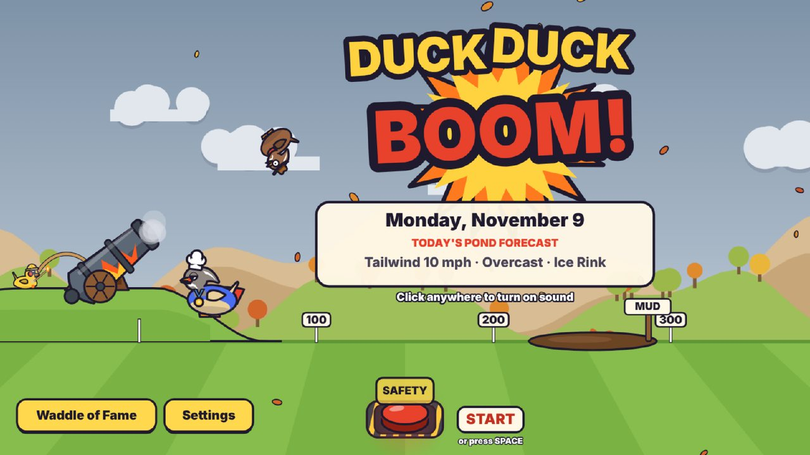
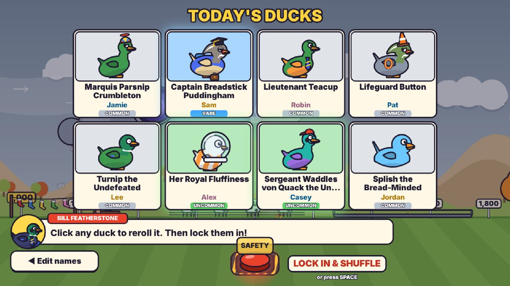
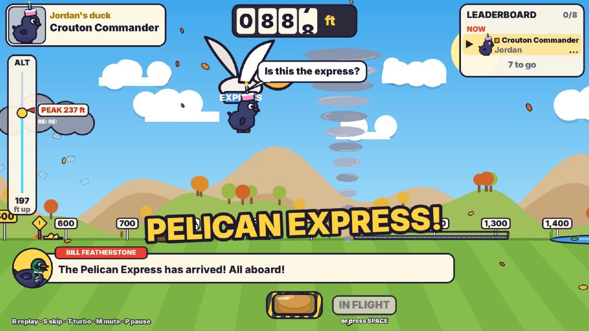
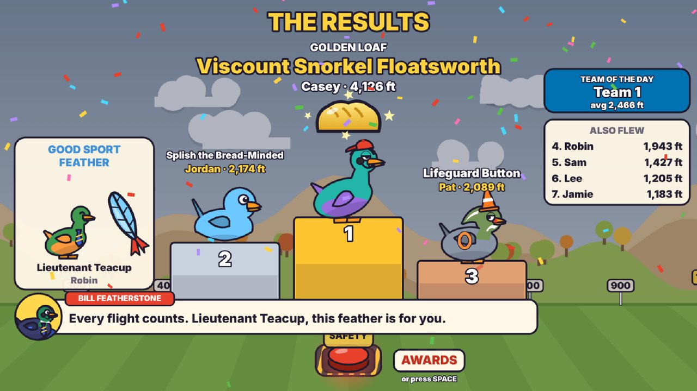

# Duck Duck BOOM!

<p align="center">
  <a href="https://sauterreed24.github.io/duck-duck-boom/"></a>
</p>

<p align="center">
  <b><a href="https://sauterreed24.github.io/duck-duck-boom/">▶ Play now</a></b>
  &nbsp;·&nbsp; <a href="https://raw.githack.com/sauterreed24/duck-duck-boom/main/index.html">Backup link</a>
  &nbsp;·&nbsp; <a href="https://github.com/sauterreed24/duck-duck-boom/blob/main/index.html">Download to play offline</a>
</p>

<p align="center"></p>

A daily cannon-launch duck game for team calls. Everyone who booked a meeting today gets a randomly generated duck. **Ol' Thunderbill** fires each one across a field full of trampolines, geese, reply-all storms and the occasional UFO. The duck that lands farthest takes home **the Golden Loaf**.

| Reveal today's ducks | Launch them one by one | Crown the winner |
| --- | --- | --- |
|  |  |  |

It is one self-contained file, `index.html`. There are no frameworks, CDNs, web fonts, images, audio files or network requests. Every visual is drawn with Canvas 2D and every sound is synthesized with the Web Audio API, so it runs offline in Chrome or Edge.

## Running it

- **Play from this page:** click **Play now** above. It opens the game at <https://sauterreed24.github.io/duck-duck-boom/>, served by GitHub Pages from the `main` branch. Nothing to install, and it updates itself about a minute after every change to `main`.
- **Backup link:** the same latest `index.html` through raw.githack.com (a free service that serves files from public GitHub repos), in case Pages is ever unavailable.
- **Offline:** download `index.html` and double-click it.

Your roster, settings and Waddle of Fame are saved in the browser for whichever link you use. Each link keeps its own copy, so stick to one. To move your data, use **Settings → Export everything** on the old link and **Import…** on the new one.

### On a Teams call

1. Share the **browser window or the whole screen**, and turn on **Include sound** in the share bar.
2. Keep the game window uncovered and in front. Browsers throttle hidden or covered tabs, which makes the show stutter.
3. Press **F** for fullscreen. The 16:9 stage scales to any window.
4. Click once before the call starts. Browsers only allow audio after the first click.
5. Turn on **Auto-advance** if you want it to run hands-free, or leave it off and banter between ducks.

If the laptop struggles while screen-sharing, the game notices the dropped frames and quietly renders at a lower internal resolution, then steps back up when things are smooth again. You don't need to change anything.

## The show

There are five screens, and the **big red button** (or **Space**) is the only control you need.

1. **Title:** the animated logo, Ol' Thunderbill idling with a smoldering fuse, today's date and the Pond Forecast teaser. If today's show was interrupted, the button reads **RESUME SHOW**. A finished show never comes back on the big button: it's already in the Waddle of Fame, and **Last results** reopens its panorama for copying. An unfinished show from an earlier day leaves the big button on **START** and gets its own dated **Resume** button instead.
2. **Who booked today?** A saved roster grouped by three teams, up to 40 ducks. See [Editing today's names](#editing-todays-names) below. You can also tick **Practice race** (not saved, and it switches itself off when the page reloads), **Auto-advance** and **Turbo** here.
3. **Duck reveal:** cards flip in a cascade and pause on Epic and Legendary ducks. Click any card to reroll that duck. Spotted a typo or a missing person? **◀ Edit names** goes back to the roster before anything starts. **LOCK IN & SHUFFLE** shuffles the launch order on screen, then the **Pond Forecast** appears.
4. **Launches:** one duck at a time. **NEXT DUCK** plays the intro card and the ladder climb. The safety cover flips open, then **LIGHT THE FUSE** runs the 3-2-1 countdown, the launch call "FIRE IN THE DUCK!", the flight, the landing and the leaderboard update.
5. **Results:** a podium with the Golden Loaf (with the winning margin when it's close), the Good Sport Feather and a list of everyone else, then awards and highlights, then a panorama of every landing flag with **Copy results** for the team chat.

### Editing today's names

The roster is saved in the browser, so you only build it once. Each day you just change who's ticked.

- **Today's list** (the quickest way): paste or type who booked today, one name per line. Add `, Team 2` (or a team's name) to set the team. Rows copied from a spreadsheet (tab-separated; only a cell that is just a team, like `Team 2` or `2`, sets the team), `Last, First` names and Outlook attendee lists (`"Name" <email>` or bare addresses) are understood too. `Jamie, Sam` with two people already on the roster ticks both. **Tick only these** ticks exactly those people and unticks everyone else. **Add to ticked** keeps the people already ticked. New names are added to the roster automatically, and bullets or numbers at the start of a line are ignored, so you can paste straight from a chat message.
- **Fix a name:** click it and type. Enter saves, Esc undoes. A blank name goes back to the old one, and a name that's already taken gets a `(2)` suffix.
- **Tick or untick** anyone with the checkbox, or a whole team with **All** / **None**. The two small coloured dots on each row move someone straight to that team, and **×** removes them from the roster. Anything half-typed in the side boxes stays put while you tick and untick.
- **Find a name** filters the lists when the roster gets long. Names are sorted alphabetically within each team.
- **New day:** if ticks are left over from an earlier day, a yellow banner offers to untick them. Each person's tick remembers its day, so people you tick or add today are never caught by it.
- **More than 40 ticked:** the warning names who sits out (the roster's own order: team, then name), and so does a note when the show starts.
- **During the show** (press **P**): **Add a late player** launches them last, and **Remove someone who hasn't launched yet** takes out a duck that was ticked by mistake.

### Keys

| Key | Action |
| --- | --- |
| Space | The big red button |
| R | Instant replay of the last flight, with sound and captions. Replays use the quicker turbo pacing. |
| T | Turbo (about 1.5x overall): shorter intros and countdown, quicker flights. |
| S | Skip to this flight's result (silent) |
| M | Mute |
| F | Fullscreen |
| P | Pause and settings: add a late player, remove a duck that hasn't launched, teams, volume, data. Pause freezes everything, sound included. P again resumes. |

Hotkeys are ignored while you're typing in a text field. Esc stays the browser's fullscreen exit.

### Pacing

At 1x, each duck takes roughly 24 seconds: intro 1.5 s, ladder and gauges 2.5 s, countdown 3 s, the flight and a 2.5 s result. A flight with no events plays for about 11 s, a typical one about 12 s, and one packed with events 15–20 s (9 in 10 flights are done within 18 s; the rare monster flight tops out around 24 s). In turbo a typical flight takes about 8 s.

Flights play close to real time. The launch always plays at exactly full speed, and every event, the landing and the finish play at or very near it. Only quiet stretches run faster, and the speed always eases up and down, so the duck never appears to skip ahead. Close to the ground it barely speeds up; it speeds up most high in the sky, where the camera is zoomed far out. A long quiet slide or bounce-out is fitted into a few seconds, and the camera pulls back while it runs faster so the scenery never streaks past. Captions and speech bubbles always run in real time and stay up for at least 2 seconds. Shows with more than 15 ducks start in turbo.

## What's in it

- **Ducks:** seeded per player per day (local date + name), so a reload gives the same duck. There are 5 base types (mallard, classic rubber duck, fluffy duckling, white farm duck, Carolina duck), 16 colors, 6 patterns, 16 hats, 17 accessories and 8 eye styles. Rarities are Common 60%, Uncommon 25%, Rare 10%, Epic 4% and Legendary 1%. The six legendaries are Golden Duck, Disco Ball Duck, Robo-Duck, Ghost Duck, Pixel Duck and Definitely A Duck (a goose in a duck costume). Names mix templates with 96 handwritten one-offs and avoid names used on recent days. Every generated name, bio and caption goes through a blocklist, and any duck name containing a first name from the roster is rerolled. Looks never affect distance.
- **Events:** 12 boosts, 12 obstacles (pond plop included), 7 wildcards and 9 gags. Each one is a data entry in `C.EVENTS` with its trigger, physics effect, art, sound and caption. Ground set pieces come from the day's course and trigger on a seeded chance per flight. Air events trigger by chance in their altitude band. Gags never change distance.
- **Cannon moments:** misfire with a bonus-powder comeback (about 1.3%), backfire to a negative distance (about 1%) and the fake-out fizzle (about 2%, cosmetic only). Other flight touches are the hat that flies off and sometimes beats its duck, a photo finish in slow motion when a duck lands within 25 ft of the leader (with the margin called out), **personal bests**, and a drumroll for a last duck who can still win, which builds over the final seconds of the flight and ends right on the landing cymbal.
- **Daily conditions:** wind (calm, tailwind or headwind, up to 20 mph), sky (sunny, overcast, drizzle, fog, sunset or night) and a modifier of the day on about half of days: Low Gravity, Bouncy Day, Goose Migration, Trampoline Park, Ice Rink (some ponds freeze over), Big Head Mode, Throwback Mode or Turbo Cannon. Fridays add Fri-Yay party mode. Seasonal themes come from the date: pumpkins and bats in October, falling leaves in autumn, a turkey in a duck disguise during Thanksgiving week, snow and twinkle lights from December to February, flowers and rain in spring, and a beach in summer. The course changes daily too.
- **Commentary:** Bill Featherstone narrates in a lower-third caption bar (about 200 lines), and the ducks talk back in speech bubbles (about 115 lines). Lines are drawn from shuffled bags so nothing repeats within a show, and Bill always talks about what's happening now instead of falling behind. Commentary roasts the duck, never the player. An optional announcer voice uses the Web Speech API and is off by default.
- **Show moments:** the next few ducks wait their turn on the hill (**UP NEXT**) and hop when the cannon fires, and each duck waddles over to the ladder. Bill invites the call to count down the first launch, welcomes back the last show's champion and anyone on a winning streak, announces **Bill's pick** to win after the Pond Forecast (it's also tagged on that duck's card) and owns up at the end, and the results crown a **Team of the Day** (the team whose ducks flew farthest on average). Leaderboard rows slide into place when a duck takes the lead. On the title screen, Thunderbill lobs a demo duck every few seconds while people join. During a flight, a chip under the distance counter shows the live gap to the leader (it turns green once the duck is ahead), the altitude gauge keeps a **PEAK** marker, Bill calls the top of the arc and the first touchdown when nothing else is happening, and a long slide gets a **STILL GOING!** banner and a word from the duck.
- **Sound:** fuse sizzle, crank clicks, the cannon BOOM, whoosh, slide whistle, BOING, splat, honk, bonk, bell DING, per-duck quacks, crowd ooh and cheer, sad trombone and a kazoo fanfare. All melodies are original. Everything runs through one compressor and a limiter, and the volume slider scales the whole mix evenly. The default volume is 60%. Long sounds stop when you skip a flight or leave the screen.
- **Waddle of Fame:** wins per player and per team, the current win streak, the top 10 longest launches, Duck of the Month standings and a log of legendary moments. The last real race's winner gets a small crown, and a new pond record gets fireworks.
- **Bonus Ammo** (off by default): in Settings, turn it on, then give a player up to 3 extra shots on the roster screen. Bonus shots launch at the end, and each player's best shot counts.

## Fairness

- Every random number comes from seeded PRNGs (`mulberry32` seeding `sfc32`). `Math.random` is never used.
- The local date (`YYYY-MM-DD`, never `toISOString()`) seeds the ducks, the conditions and the course.
- Each race gets a fresh seed from `crypto.getRandomValues`, shown as the Race ID.
- Each flight's seed is `hash(raceSeed, playerKey, shotNumber)`, so launch order, late additions and looks never change anyone's distance.
- `sim(seed, conditions, course, duck)` runs a fixed 120 Hz simulation and returns a timeline. The renderer only plays it back.
- The race (seed, roster, rerolls, order, current index and results) is saved after every step, so a reload mid-show resumes the exact race.

## Data

- Everything is saved in `localStorage` under keys starting with `ddb.v1.`, wrapped as `{schema, data}`. `localStorage.clear()` is never called, because all of a github.io account's sites share one storage origin. Reset only removes `ddb.v1.*` keys.
- If storage is blocked, the game still runs and keeps everything in memory for the session. If storage is full, the saved roster and history still load, and the title screen and Settings warn that new changes aren't being saved.
- **Settings → Export everything** downloads a JSON backup, and **Import…** or **Paste import text…** restores it. It's a full restore: it checks the backup first, refuses a damaged one, and asks before it would erase saved races, the roster or a show in progress. When a hosted frame blocks downloads or the clipboard, the game shows a text box you can copy from.

## QA tools

- `index.html?debug` opens a debug panel. It can set the date and race seed, fake N players, force any event, gag or cannon moment for the next flight, force a rarity, wind, sky, modifier, season or Friday, and run a sound check. It also shows an FPS meter and has balance and self-test buttons.
- `index.html?gallery` shows 24 random ducks on one screen. Press Space for a new batch.
- In the browser console:
  - `DDB.balance(10000)` simulates N flights across a year of daily conditions. It prints the distance spread, how often each event fires, how many events each flight got, and how often the winner of a 10-duck race had each event.
  - `DDB.selfTest()` runs a 40-player race twice with the same seed and checks that the results match exactly with no NaN values. It also checks that launch order and looks don't change distances, that rerolls and same-day ducks behave, that no flight ends in mid-air or at the time cap, and that every commentary line and name part passes the content blocklist.

Latest balance run (10,000 flights):

```text
distance  min -622  p10 721  p25 1,037  median 1,372  p75 1,839  p90 2,452  p99 4,156  max 6,861 ft
past 2,500 ft: 9.2%   past 5,000 ft: 2.4 per 1,000   backfire: 0.91%   misfire: 1.26%
distance-changing events per flight: 1.93 avg   0: 15.9%  1: 32.4%  2: 21.3%  3: 13.2%  4: 7.8%  5: 9.3%
most decisive events: jet stream (the winner had it in 36% of races) and spicy pepper (33%)
```

## Code layout

`index.html` is one inline `<style>` block and one `<script>` block, organized into labeled sections:

| Section | Contents |
| --- | --- |
| `RNG` | Hashing, `mulberry32`, `sfc32`, the `Rng` helper, date keys |
| `CONTENT` | Every name, bio, stat, line, event, award and label, as data tables (`C.*`) |
| `STORAGE` | `ddb.v1.` storage wrapper, settings, roster, history, export/import, Waddle of Fame stats |
| `DUCKS` | Duck generator, name blocklist, rarity |
| `WORLD` | Daily conditions, seasons, course generator |
| `SIM` | The fixed-timestep flight simulation, event effects, cosmetic gags, balance tester and self test |
| `ART` | Ducks, Ol' Thunderbill, set pieces, actors, scenery, flags, Bill, trophies, logo, the big red button |
| `AUDIO` | Web Audio synth, all sound effects, announcer voice |
| `UI` | Screens, captions, launch sequence and playback, HUD, results, Waddle of Fame, roster and settings, debug panel |
| `BOOT` | Main loop, input, hotkeys, resize, `window.DDB` |

To add an event, add an entry to `C.EVENTS` and give it a physics effect in `SIM`'s `FX` table (or a piece type in `PIECE_DEFS`). Then add art in `ART.piece` or the actor switch, and optional `ev_<id>` lines in `C.LINES`.

## Not included

- **Salvo mode** (every duck fires at once). It was the last stretch goal and was left out to keep the core show solid.
